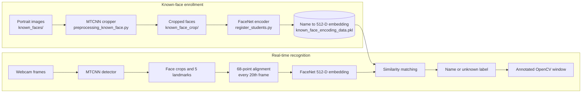
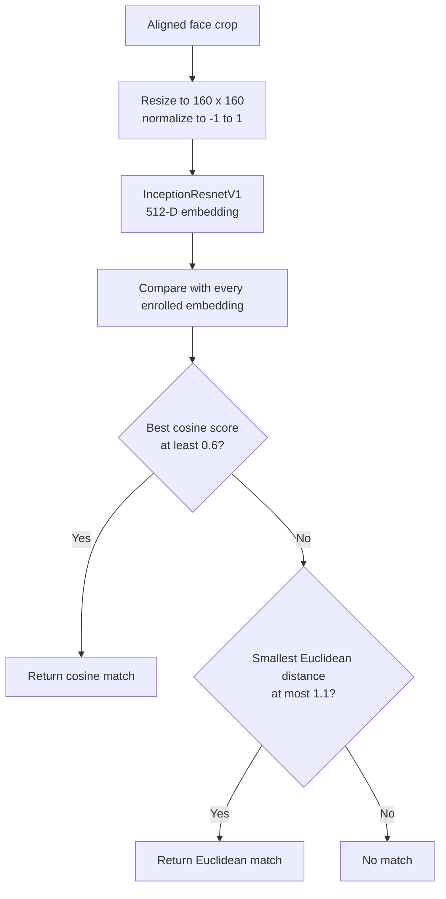

# Real-Time Face Recognition System

A Python prototype for enrolling known people and identifying faces from a webcam. The primary pipeline combines MTCNN face detection, 68-point landmark alignment, and FaceNet embeddings, then labels a detected face using cosine similarity or Euclidean distance.

> [!IMPORTANT]
> Despite the package name `realtime-attendance-system`, this repository does **not yet record attendance**. It recognizes faces and displays names. Attendance events, timestamps, deduplication, and persistence are future work.

## What is implemented

| Capability | Status | Implementation |
| --- | --- | --- |
| Webcam face detection | Working prototype | MTCNN via `facenet-pytorch` |
| Face alignment | Working prototype | 68 landmarks via `face-alignment`; roll correction only |
| Face embeddings | Working prototype | 512-dimensional InceptionResnetV1 embeddings pretrained on VGGFace2 |
| Real-time identification | Working prototype | Cosine similarity first, Euclidean distance as fallback |
| Known-person enrollment | Script available | Cropped images are encoded into a local pickle file |
| Video-file and batch processing | Experimental | Separate scripts with hard-coded paths |
| RetinaFace detection | Experimental | Standalone detector, not connected to recognition |
| PostgreSQL storage | Legacy/partial | Helper and legacy script exist; the real-time path does not use them |
| Attendance recording | Not implemented | No attendance table or check-in/check-out workflow exists |
| Automated tests/package CLI | Not implemented | Scripts are run from their source directories |

## System architecture

The project has two main flows: create the known-face gallery once, then use that gallery during webcam recognition.



### Recognition decision



MTCNN runs on every frame. Alignment and recognition run every 20th frame to reduce work; labels are reused between those frames. The current cache associates labels with face-list positions, not with tracked identities, so labels can move between people when detection order changes.

## How the pipeline works

### 1. Enrollment

`preprocessing_known_face.py` detects faces in source portraits and writes cropped faces to `known_face_crop/`. `register_students.py` resizes each crop to 160 × 160, normalizes its pixels, creates a 512-dimensional FaceNet embedding, and serializes this mapping:

```text
person name -> torch.Tensor with 512 values
```

The person's name is derived from the filename stem after **all digits are removed**. For example, `alice1.jpg` and `alice2.jpg` both become `alice`. Because the gallery is a dictionary, later images with the same derived name overwrite earlier embeddings; the current implementation retains one embedding per name.

### 2. Detection

The main runtime uses `facenet_pytorch.MTCNN(keep_all=True)` to return bounding boxes, confidence values, and five landmarks for every detected face. MTCNN automatically uses CUDA when PyTorch reports that it is available; otherwise it uses the CPU.

### 3. Alignment

`face-alignment` finds 68 landmarks. The mean positions of landmarks 36–41 and 42–47 define the eye centers, and the crop is rotated until the eyes are horizontal. Offline alignment also estimates yaw and pitch for logging, but neither angle is corrected.

### 4. Recognition

The aligned crop passes through `InceptionResnetV1(pretrained="vggface2")`. Runtime matching applies these rules in order:

1. Return the identity with the highest cosine similarity if it is at least `0.6`.
2. Otherwise, return the identity with the smallest Euclidean distance if it is at most `1.1`.
3. Otherwise, return no match.

These thresholds are starting points from the prototype, not calibrated guarantees. Tune them against validation images from the actual camera, lighting, distance, and population used in deployment.

## Requirements

- Python 3.12 or newer (as declared in `pyproject.toml`)
- A webcam for the primary real-time path
- A desktop session capable of displaying OpenCV windows
- Internet access on first use so pretrained model weights can be downloaded
- Optional NVIDIA GPU and a compatible CUDA/PyTorch installation for faster MTCNN detection
- Optional PostgreSQL only for the legacy database experiment

The checked-in `requirements.txt` is a large, fully pinned environment snapshot, not a minimal dependency specification. It combines PyTorch 2.2 with Torchaudio 2.9 and CUDA 12/13 packages, so it may not resolve cleanly on a new machine. The core runtime uses OpenCV, NumPy, Pillow, PyTorch/Torchvision, `facenet-pytorch`, `face-alignment`, and `face-recognition`.

## Installation

From the repository root:

```bash
python3.12 -m venv .venv
source .venv/bin/activate
python -m pip install --upgrade pip
python -m pip install torch==2.2.2 torchvision==0.17.2
python -m pip install opencv-python==4.11.0.86 numpy==1.26.4 pillow==10.2.0 \
  facenet-pytorch==2.6.0 face-alignment==1.4.1 face-recognition==1.3.0
```

This is the smaller dependency set used by the main enrollment and real-time paths. Install `psycopg2-binary`, `python-dotenv`, or `retina-face` only if using the corresponding experimental scripts. On Windows, activate the environment with `.venv\Scripts\activate` instead. Some platforms require native build tools for `dlib`/`face-recognition`; GPU users should install a PyTorch build compatible with their driver by following the official PyTorch selector rather than installing every CUDA package in `requirements.txt`.

> [!NOTE]
> Most scripts use paths relative to the **current working directory**, not relative to the script file. Run the following commands from the directories shown.

## Quick start

### 1. Prepare source portraits

Create the input directories at the repository root:

```bash
mkdir -p known_faces known_face_crop
```

Add clear, front-facing portraits. Use numeric suffixes if desired; the suffix is removed when the name is created.

```text
known_faces/
├── alice1.jpg
├── bob1.jpg
└── charlie1.jpg
```

Use one face per image. The cropper can detect several faces, but it writes each result to the same output filename, so only the last crop survives.

### 2. Crop the portraits

```bash
cd src/preprocessing-phase
python preprocessing_known_face.py
cd ../..
```

This creates cropped images in `known_face_crop/`.

### 3. Build the embedding gallery

The current registration script expects its pickle file to exist before its first run. Seed it once with an empty dictionary:

```bash
cd src/face_detection_and_recognition
python -c 'import pickle; pickle.dump({}, open("known_face_encoding_data.pkl", "wb"))'
python register_students.py
```

The resulting `known_face_encoding_data.pkl` must stay in this directory because the runtime opens it from the current working directory. Rerun `register_students.py` whenever the portrait set changes.

### 4. Start real-time recognition

While still in `src/face_detection_and_recognition`:

```bash
python main.py
```

An OpenCV window displays detected faces and their last recognized labels. Press `q` while the window is focused to exit.

## Script guide

| Script | Role | Notes |
| --- | --- | --- |
| `main.py` | Primary entry point | Starts the real-time MTCNN pipeline |
| `face_detection_realtime.py` | Webcam orchestration | Detects every frame; recognizes every 20th frame |
| `align_faces_realtime.py` | Runtime alignment | Corrects roll, then calls FaceNet recognition |
| `face_recognition_realtime.py` | Runtime embedding and matching | Loads the pickle gallery at import time |
| `preprocessing_known_face.py` | Enrollment preprocessing | Crops source portraits with MTCNN |
| `register_students.py` | Gallery builder | Writes one embedding per derived name |
| `face_detection_mtcnn.py` | Offline webcam detector | Saves crops; its alignment handoff currently targets a different input folder |
| `face_detection_mtcnn_test_video.py` | Video detector | Hard-coded to `test-videos/attendance2.mp4` |
| `align_faces.py` | Batch alignment | Hard-coded to read video-test crops |
| `face_recognition_facenet.py` | Batch FaceNet experiment | Requires a PostgreSQL connection even though its SQL block is commented out |
| `face_detection_retinaface.py` | Alternative detector experiment | Detection only; no alignment or recognition |
| `face_recognition_by_similartiy.py` | Legacy dlib/PostgreSQL experiment | Creates tables and inserts data immediately when run |
| `db_connection.py` | PostgreSQL connection helper | Reads credentials from environment variables |

## Project layout

```text
face-recognition-system/
├── README.md
├── FACE_RECOGNITION_EXPLAINED.md
├── pyproject.toml
├── requirements.txt
└── src/
    ├── preprocessing-phase/
    │   └── preprocessing_known_face.py
    └── face_detection_and_recognition/
        ├── main.py
        ├── face_detection_realtime.py
        ├── align_faces_realtime.py
        ├── face_recognition_realtime.py
        ├── preprocessing and batch experiment scripts
        └── known_face_encoding_data.pkl  # generated locally

# Generated locally and intentionally not present in a fresh clone:
known_faces/
known_face_crop/
detected-faces-mtcnn*/
detected-aligned-faces-mtcnn/
test-videos/
```

For a deeper explanation of the embedding and similarity calculations, see [FACE_RECOGNITION_EXPLAINED.md](FACE_RECOGNITION_EXPLAINED.md).

## Optional PostgreSQL experiment

The real-time application does not need a database. `db_connection.py` supports these environment variables for the older batch scripts:

```dotenv
DB_HOST=localhost
DB_PORT=5432
DB_USERNAME=postgres
DB_PASSWORD=change-me
DB_DATABASE=face_recognition
```

The legacy schema consists of `students` and `students_face_encoding`. It has no attendance table. Be aware that `face_recognition_by_similartiy.py` performs table creation and inserts at module level and does not prevent duplicate rows.

## Configuration

The prototype currently uses source-code constants rather than a configuration file:

| Setting | Current value | Location |
| --- | ---: | --- |
| Recognition interval | Every 20th frame | `face_detection_realtime.py` |
| Face alignment minimum size | 160 px | `align_faces_realtime.py` |
| FaceNet input | 160 × 160 RGB | Recognition and registration scripts |
| Cosine threshold | `0.6` | `face_recognition_realtime.py` |
| Euclidean threshold | `1.1` | `face_recognition_realtime.py` |
| Webcam index | `0` | Detection scripts |

Changing these values requires editing the relevant script.

## Known limitations

- Recognition is identification, not attendance tracking; no check-in record is created.
- File and directory paths are hard-coded and depend on the launch directory.
- The gallery pickle is Python-specific, unsafe to load from untrusted sources, and contains Torch tensors rather than a portable data format.
- Runtime FaceNet is not explicitly moved to CUDA, so detection may use the GPU while recognition remains on the CPU.
- Enrollment images are loaded as RGB, while real-time OpenCV crops are passed to Pillow without BGR-to-RGB conversion; this channel-order mismatch can reduce recognition accuracy.
- Face labels are cached by detection-array index rather than by a face tracker.
- Bounding boxes are not clamped to frame boundaries before cropping.
- Multiple portraits with the same derived name do not produce a multi-sample template; the last dictionary value wins.
- An empty gallery, a missing pickle, or a missing input directory causes an exception rather than a guided error.
- The offline detector/alignment scripts do not currently form a consistent end-to-end path without editing their hard-coded directories.
- There are no automated tests, packaging entry points, liveness checks, or anti-spoofing protections.
- Thresholds have not been calibrated or benchmarked in this repository.

## Troubleshooting

### `FileNotFoundError: known_face_encoding_data.pkl`

Run the gallery-building step and launch `main.py` from `src/face_detection_and_recognition`.

### `FileNotFoundError` for `known_faces` or `known_face_crop`

Create the directories at the repository root and run each script from the directory shown in Quick start.

### The webcam cannot be opened

Check camera permissions, close applications already using the camera, and change `cv2.VideoCapture(0)` if the camera has another index. GUI-based OpenCV capture will not work unchanged on a headless server.

### A known person is not recognized

Use sharp, well-lit, front-facing enrollment images; verify that cropping found the intended face; add controlled samples in the actual camera environment; then calibrate the thresholds using genuine and impostor comparisons rather than increasing them blindly.

### Recognition is slow

Confirm whether PyTorch can see CUDA, reduce the input resolution, or increase the 20-frame recognition interval. Note that the current FaceNet model remains on the CPU unless the code is changed to move both model and tensors to the same CUDA device.

### Model weights fail to load

The first run downloads pretrained weights for FaceNet and alignment models. Confirm internet access and the relevant Torch cache permissions.

## Responsible use

Face embeddings are biometric data. Obtain informed consent, restrict access to source photos and generated embeddings, define a retention policy, and provide a non-biometric attendance alternative. Before any real deployment, evaluate false accepts and false rejects across the intended population and conditions, add liveness/anti-spoofing controls, and review applicable privacy and biometric-data laws.

## Suggested next steps

1. Replace working-directory-relative paths with `pathlib.Path(__file__)`-based configuration and add a CLI.
2. Make gallery creation atomic, support several embeddings per person, and validate empty or malformed galleries.
3. Add a face tracker so cached labels remain attached to the correct person.
4. Add an attendance event model with timestamps, uniqueness rules, and explicit database migrations.
5. Calibrate thresholds from a representative validation set and publish accuracy/latency measurements.
6. Add unit tests for naming, embedding comparison, and configuration plus integration tests with fixture images.
